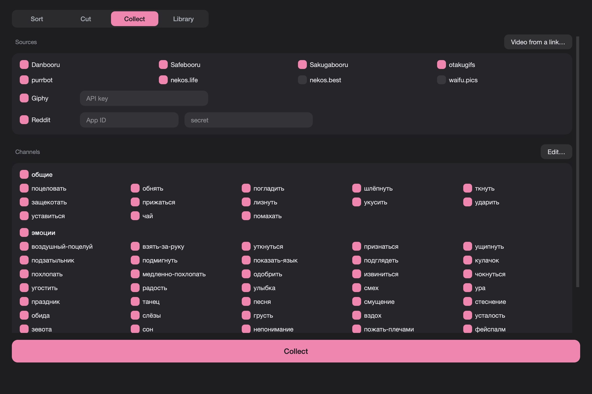

# Gifki

Collects, sorts and cuts reaction GIFs for a Discord GIF server: one channel per
action ("hug", "wave", "cry"), and a label in the message telling who acts on
whom.

[Русский](#gifki-1)



## Download

**[Gifki.dmg](https://github.com/Drtonix/Gifki/releases/latest/download/Gifki.dmg)**

First launch goes through right-click → **Open** → **Open**.

## Requirements

Apple Silicon, macOS 13 or newer, or Windows 10/11 x64 (`build_windows.sh`).

## How it works

**Collect.** From Danbooru, Safebooru, Sakugabooru, Reddit, Giphy and the
anime reaction APIs (otakugifs, purrbot, nekos.life, nekos.best, waifu.pics),
general and safe ratings only. Giphy and Reddit need your own keys.

**Sort.** One GIF at a time, keys 1–7 save it with a label: М or Ж for one
person, МЖ, ЖМ, ММ, ЖЖ for who acts on whom (М is a man, Ж is a woman),
7 for universal. Shift adds several labels, X drops, → skips, C sends to Cut,
⌘Z undoes.

**Cut.** A video, a link (YouTube, VK Video, Rutube and others) or a file:
mark in and out, crop and save the segment as a GIF. Streams are cut without
downloading the whole video. Discord takes GIFs up to 10 MB.

**Library.** `<library>/<group>/<channel>/<label>/`, ready to upload.

**Channels.** Each has its own search: booru tags, a Giphy query, anime API
reactions. Your own full set can go in `channels_local.py` next to
`actions.py`; it replaces the built-in one and is ignored by git.

**Languages.** Russian and English, light and dark appearance.

## Build

```
git clone git@github.com:Drtonix/Gifki.git
cd Gifki
uv sync
./build_app.sh
```

The first build compiles FFmpeg, which takes a few minutes. To run from
source: `uv run python app.py`.

## License

MIT, see [LICENSE](LICENSE). Bundled components are in
[THIRD-PARTY.md](THIRD-PARTY.md).

DrTonix · [bdub.space](https://bdub.space)

---

# Gifki

Собирает, разбирает и нарезает гифки-реакции для гиф-сервера в Discord: одно
действие — один канал («обнять», «помахать», «слёзы»), а метка в сообщении
говорит, кто действует и на кого.

[English](#gifki)


## Скачать

**[Gifki.dmg](https://github.com/Drtonix/Gifki/releases/latest/download/Gifki.dmg)**

Первый запуск — правой кнопкой → **Открыть** → **Открыть**.

## Требования

Apple Silicon, macOS 13 или новее, либо Windows 10/11 x64 (`build_windows.sh`).

## Как работает

**Сбор.** С Danbooru, Safebooru, Sakugabooru, Reddit, Giphy и аниме-API
реакций (otakugifs, purrbot, nekos.life, nekos.best, waifu.pics), только
рейтинги general и safe. Для Giphy и Reddit нужны свои ключи.

**Разбор.** По одной гифке, клавиши 1–7 сохраняют с меткой: М или Ж — один
человек, МЖ, ЖМ, ММ, ЖЖ — кто на кого, 7 — универсальная. Shift добавляет
несколько меток, X выкидывает, → пропускает, C отправляет в нарезку, ⌘Z
отменяет.

**Нарезка.** Видео, ссылка (YouTube, VK Видео, Rutube и другие) или файл:
отметьте начало и конец, обрежьте кадр и сохраните отрезок гифкой. Потоки
нарезаются без скачивания всего видео. Discord берёт гифки до 10 МБ.

**Подборка.** `<подборка>/<группа>/<канал>/<метка>/`, готово к выгрузке.

**Каналы.** У каждого свой поиск: теги бур, запрос Giphy, реакции аниме-API.
Свой полный набор можно держать в `channels_local.py` рядом с `actions.py`:
он заменяет встроенный и в git не попадает.

**Языки.** Русский и английский, светлое и тёмное оформление.

## Сборка

```
git clone git@github.com:Drtonix/Gifki.git
cd Gifki
uv sync
./build_app.sh
```

Первая сборка компилирует FFmpeg, это несколько минут. Из исходников:
`uv run python app.py`.

## Лицензия

MIT, см. [LICENSE](LICENSE). Компоненты — в [THIRD-PARTY.md](THIRD-PARTY.md).

DrTonix · [bdub.space](https://bdub.space)
